<!--
  The images are drawn by scripts/build.py from the words in scripts/profile.toml.
  The activity card and the snake are redrawn every night by .github/workflows/activity.yml.
-->

<a href="https://iamsemacakir.github.io/">
  <picture>
    <source media="(prefers-color-scheme: dark)" srcset="assets/header-dark.svg">
    
  </picture>
</a>

  <a href="https://iamsemacakir.github.io/"><picture><source media="(prefers-color-scheme: dark)" srcset="assets/link-portfolio-dark.svg"></picture></a>
  <a href="https://www.linkedin.com/in/SemaYasharova"><picture><source media="(prefers-color-scheme: dark)" srcset="assets/link-linkedin-dark.svg"></picture></a>
  <a href="mailto:semacakir.business@gmail.com"><picture><source media="(prefers-color-scheme: dark)" srcset="assets/link-email-dark.svg"></picture></a>
  <a href="https://www.instagram.com/iamsemacakir/"><picture><source media="(prefers-color-scheme: dark)" srcset="assets/link-instagram-dark.svg"></picture></a>

### A bit about me

I'm Sema, a software engineer and Master's student at the University of Ruse "Angel Kanchev". I like turning rough ideas into calm, useful interfaces and systems that people can actually enjoy using.

I care about code that other people can understand. Teaching math and programming keeps me close to the basics, and building projects keeps me curious about how small choices make a product feel easier, faster and kinder to use.

- 🔧 Building [AutoFlow](https://github.com/iamsemacakir/AutoFlow), a management system for independent car workshops
- 👩‍🏫 Teaching programming and math to students from 1st to 12th grade at EduQuest
- 📍 Ruse, Bulgaria and Hamburg, Germany
- 💬 Bulgarian and Turkish (native), English (B2/C1), German (A1/A2)

### My journey

<picture>
  <source media="(prefers-color-scheme: dark)" srcset="assets/journey-dark.svg">
  
</picture>

### Things I've built

  <a href="https://github.com/iamsemacakir/AutoFlow"><picture><source media="(prefers-color-scheme: dark)" srcset="assets/card-autoflow-dark.svg"></picture></a>
  <a href="https://github.com/iamsemacakir/hydra/tree/feature/ui-redesign"><picture><source media="(prefers-color-scheme: dark)" srcset="assets/card-hydra-dark.svg"></picture></a>
  <a href="https://github.com/iamsemacakir/LangForU"><picture><source media="(prefers-color-scheme: dark)" srcset="assets/card-langforu-dark.svg"></picture></a>
  <a href="https://travelis.sadulov.com/"><picture><source media="(prefers-color-scheme: dark)" srcset="assets/card-travelis-dark.svg"></picture></a>

Live demos: [AutoFlow](https://iamsemacakir.github.io/autoflow/), [LangForU](https://langforu.onrender.com/) and [Travelis](https://travelis.sadulov.com/).

### Tools I use

<picture>
  <source media="(prefers-color-scheme: dark)" srcset="https://skillicons.dev/icons?i=cs%2Cjava%2Ccpp%2Cts%2Cjs%2Cpy%2Chtml%2Ccss%2Csass%2Cdotnet%2Cspring%2Creact%2Cnextjs%2Cvue%2Ctailwind%2Cbootstrap%2Cpostgres%2Cmysql%2Cmongodb%2Cdocker%2Cgit%2Cgithubactions%2Clinux%2Cpostman%2Cselenium%2Cfigma%2Cps&perline=9&theme=dark">
  
</picture>

### My year on GitHub

<picture>
  <source media="(prefers-color-scheme: dark)" srcset="https://raw.githubusercontent.com/iamsemacakir/iamsemacakir/output/activity-dark.svg">
  
</picture>

<picture>
  <source media="(prefers-color-scheme: dark)" srcset="https://raw.githubusercontent.com/iamsemacakir/iamsemacakir/output/snake-dark.svg">
  
</picture>
